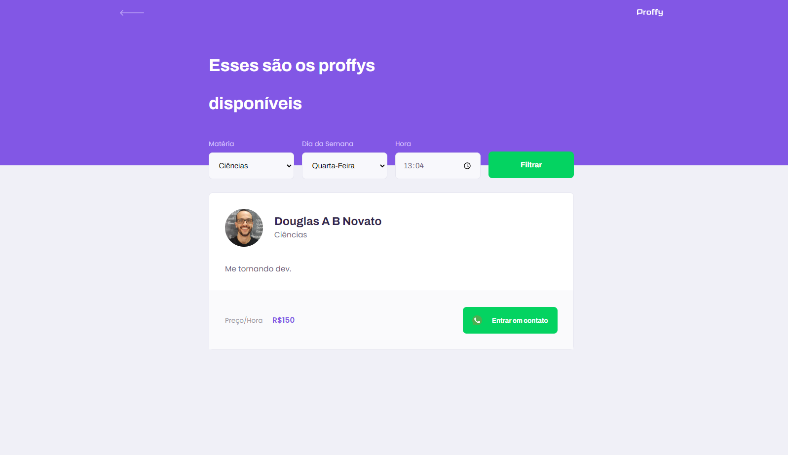
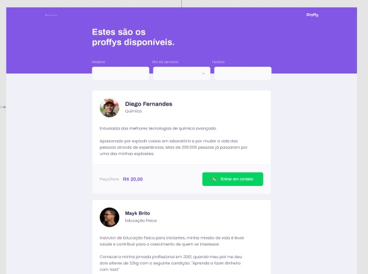
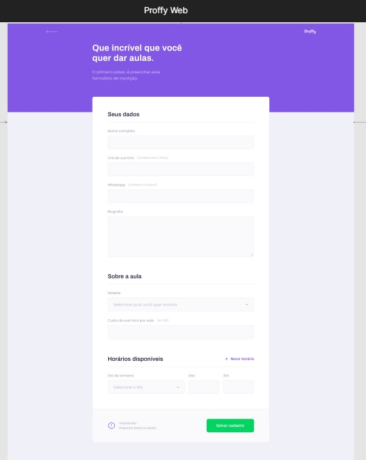
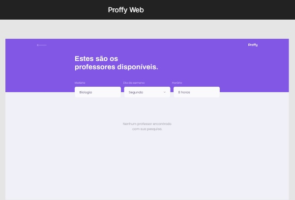

> **Projeto de estudo.** Estado conferido em 30/10/2026: Detalhes em [docs/AVALIACAO.md](docs/AVALIACAO.md) e próximos passos em [docs/PLANO-ESTRATEGICO.md](docs/PLANO-ESTRATEGICO.md).

## 🧠 O que aprendi

> Proposta de 01/11/2026, escrita a partir do código e das dependências. Ajuste com a sua experiência.

- Renderizar páginas no servidor com Express e Nunjucks.
- Guardar dados em SQLite com `better-sqlite3`.
- Limitar abuso com `express-rate-limit` e proteger cabeçalhos com Helmet.
- Testar a aplicação com `node --test`.

## Proffy



Conecta alunos a professores particulares por matéria, dia da semana e horário.

### Problema e proposta

Encontrar aula particular no horário certo depende de indicação. No Proffy o professor publica matéria, preço e horários; o aluno filtra e chama no WhatsApp.

- **Público:** estudantes do ensino básico e professores autônomos.
- **Métrica de sucesso:** conexões (contatos iniciados), contadas em `/contact/:id` e exibidas na home.

### Funcionalidades

- Cadastro de professor com vários horários, validação por campo e aviso de que os dados ficam públicos.
- Busca pela matéria, com dia e hora opcionais e os horários de cada professor no cartão; com hora, o intervalo é [início, fim) (08:30–12:00 inclui 11:59, exclui 12:00).
- Botão "Entrar em contato" que conta a conexão e abre o WhatsApp com mensagem pronta.
- Páginas de sucesso, 404 e 500.

### Stack

Node 22 · Express 4 · Nunjucks · SQLite (better-sqlite3) · helmet · node:test + supertest.

### Como rodar

```sh
npm install
npm run dev     # http://localhost:5500
npm test        # 9 testes
```

Para migrar dados de uma cópia local antiga do banco, que não está mais no Git: `DATABASE_FILE=./src/database/database.sqlite npm start` (horários corrompidos pelo bug antigo são descartados).

### Em produção

- **Fora do ar.** Em 06/11/2026, `proffy.onrender.com` respondia 200, mas servia o projeto de outra pessoa, não este. O `render.yaml` precisa de outro nome de serviço; decisão na #26. Para ver o projeto, rode localmente (seção "Como rodar").
- GitHub Pages não serve aqui: o projeto tem servidor Express e banco SQLite, e o Pages só publica arquivos estáticos.
- O SQLite de produção fica em `/tmp/proffy.sqlite`: professores e conexões cadastrados **somem a cada reinício ou deploy** (o banco sobe vazio).
- Passo a passo completo (inclui mover `ci/` para `.github/workflows/`): [docs/DEPLOY.md](docs/DEPLOY.md).

## Estado e próximos passos (ciclo de 07/11/2026)

Projeto de estudo (N1): 8 de 10 critérios aplicáveis atendidos. **Finalizado**: os dois que faltam (#27 e #28) dependem do responsável.

**O que foi feito**
- Estado de estudo registrado e comando de testes corrigido (#14).
- MVP de estudo com foco visível e `main` na inicial (#21).
- Banco com dados pessoais fora do Git (#23).
- CI também nos PRs para `developer/**`, código antigo removido, teste da página de erro (#25).
- Ciclo de 07/11: busca só pela matéria, com dia e hora opcionais e os horários no cartão (#31); título da tela Estudar em uma linha; fluxo cadastro → busca → contato percorrido na tela, com axe sem violações (#29).

**O que queremos fazer**
- #26 Decidir a publicação no Render com nome de serviço próprio (responsável).
- #27 Proteger a `master` com PR e CI obrigatórios (responsável).
- #28 Decidir o histórico com o banco de telefones (responsável).
- #30 Filtrar a busca por preço máximo.
- #33 Rodar no CI o fluxo na tela com Playwright e axe.
- #34 Tirar a largura fixa de `h1`, `span` e `a` do `main.css`.

**Onde está a documentação**
- Estado e critérios: [docs/MVP.md](docs/MVP.md)
- Plano, pesquisa, backlog e registro do fluxo na tela: [docs/PLANO-DE-ACAO.md](docs/PLANO-DE-ACAO.md) (seção "Ciclo de 07/11/2026")

### Design

| Home | Proffy | Informações | Disponíveis |
|---|---|---|---|
|  |  |  |  |

### Documentação

[docs/ANALISE.md](docs/ANALISE.md) · [docs/ARQUITETURA.md](docs/ARQUITETURA.md) · [docs/PLANO-DE-ACAO.md](docs/PLANO-DE-ACAO.md) · [docs/DEPLOY.md](docs/DEPLOY.md)

Projeto da NLW 2 (Rocketseat), evoluído por [@douglasabnovato](https://github.com/douglasabnovato).
