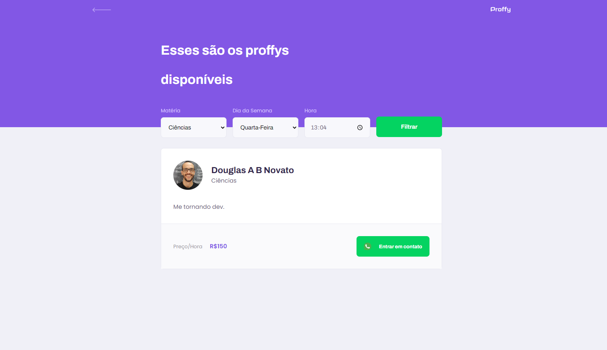
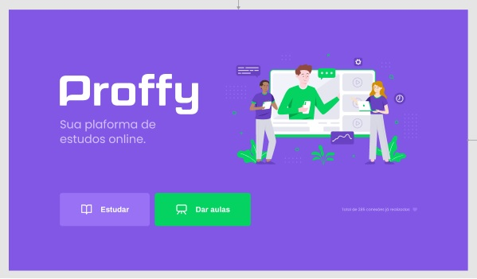
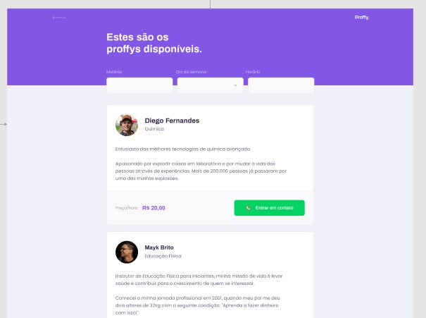
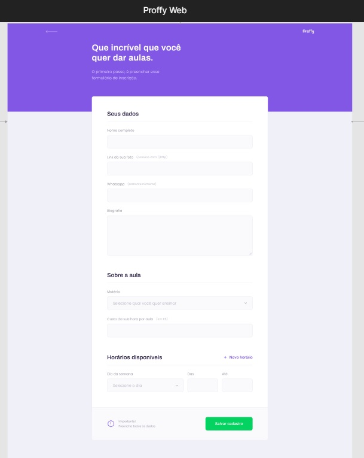
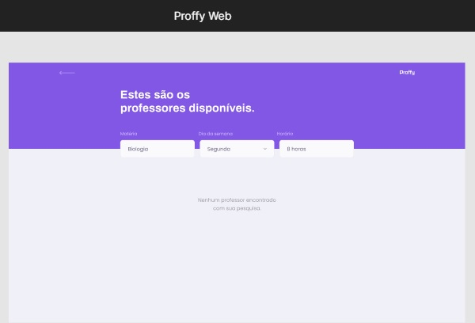

> **Projeto de estudo (N1).** Estado conferido em 16/11/2026: 8 de 10 critérios aplicáveis atendidos. Detalhes em [docs/MVP.md](docs/MVP.md); avaliação inicial de 30/10/2026 em [docs/AVALIACAO.md](docs/AVALIACAO.md).

## 🧠 O que aprendi

> Proposta de 01/11/2026, escrita a partir do código e das dependências. Ajuste com a sua experiência.

- Renderizar páginas no servidor com Express e Nunjucks.
- Guardar dados em SQLite com `better-sqlite3`.
- Limitar abuso com `express-rate-limit` e proteger cabeçalhos com Helmet.
- Testar a aplicação com `node --test`.
- Testar o fluxo no navegador com Playwright e checar acessibilidade com axe.

## Proffy



Conecta alunos a professores particulares por matéria, dia da semana, horário e preço.

### Problema e proposta

Encontrar aula particular no horário certo depende de indicação. No Proffy o professor publica matéria, preço e horários; o aluno filtra e chama no WhatsApp.

- **Público:** estudantes do ensino básico e professores autônomos.
- **Métrica de sucesso:** conexões (contatos iniciados), contadas em `/contact/:id` e exibidas na home.

### Funcionalidades

- Cadastro de professor com vários horários, validação por campo e aviso de que os dados ficam públicos.
- Busca pela matéria, com dia, hora e preço máximo opcionais e os horários de cada professor no cartão; com hora, o intervalo é [início, fim) (08:30–12:00 inclui 11:59, exclui 12:00); o preço aceita "80,50".
- Botão "Entrar em contato" que conta a conexão e abre o WhatsApp com mensagem pronta.
- Páginas de sucesso, 404 e 500.

### Stack

Node 22 · Express 4 · Nunjucks · SQLite (better-sqlite3) · helmet · node:test + supertest · Playwright + axe.

### Como rodar

```sh
npm ci
npm run dev                      # http://localhost:5500
npm test                         # 13 testes de unidade e integração
npx playwright install chromium  # uma vez
npm run test:e2e                 # 3 testes no navegador (Chromium), com axe
```

No Windows com Node 24, o `better-sqlite3` 11 não compila. Contorno sem mexer no lock: `npm ci --ignore-scripts && npm i --no-save better-sqlite3@12` (#41).

Para migrar dados de uma cópia local antiga do banco, que não está mais no Git: `DATABASE_FILE=./src/database/database.sqlite npm start` (horários corrompidos pelo bug antigo são descartados).

### Em produção

- **Fora do ar.** O serviço no Render ainda não foi criado (#26). Em 15/11/2026, `proffy.onrender.com` respondia 200, mas servia o projeto de outra pessoa (`theme-color` `#2E6D6E`). O `render.yaml` agora usa o nome `proffy-estudo`. Para ver o projeto, rode localmente (seção "Como rodar").
- GitHub Pages não serve aqui: o projeto tem servidor Express e banco SQLite, e o Pages só publica arquivos estáticos.
- No Render Free, o SQLite fica em `/tmp/proffy.sqlite`: professores e conexões **somem a cada reinício ou deploy** (o banco sobe vazio).
- Passo a passo: [docs/DEPLOY.md](docs/DEPLOY.md).

## Estado e próximos passos (ciclo de 15/11/2026)

Projeto de estudo (N1): 8 de 10 critérios aplicáveis atendidos. **Finalizado**: sim; o que falta (critério 9, #28, e critério 10, #27) depende do responsável. O ciclo de 07/11 e o de 15/11 esperam o merge da sprint na `master` (PR #37).

**O que foi feito**
- Estado de estudo registrado e comando de testes corrigido (#14).
- MVP de estudo com foco visível e `main` na inicial (#21).
- Banco com dados pessoais fora do Git (#23).
- CI também nos PRs para `developer/**`, código antigo removido, teste da página de erro (#25).
- Busca só pela matéria, com dia e hora opcionais e os horários no cartão; título da tela Estudar em uma linha (#35).
- Critério 10 com a `master` protegida (#38).
- Ciclo de 15/11: teste de tela com Playwright e axe no CI; contraste do botão Estudar no celular; filtro por preço máximo; deploy preparado com nome de serviço próprio (#40). O app não tem tema escuro próprio; o teste roda só no modo claro.

**O que queremos fazer**
- #36 Mesclar a sprint na `master` (responsável).
- #26 Criar o serviço no Render com o nome `proffy-estudo` (responsável).
- #27 Exigir os checks `raiz` e `e2e` no ruleset da `master` (responsável).
- #28 Decidir o histórico com o banco de telefones (responsável).
- #34 Tirar a largura fixa de `h1`, `span` e `a` do `main.css`.
- #41 Atualizar Express, `better-sqlite3` e `express-rate-limit` para as versões maiores.
- #42 Servir as fontes do próprio servidor, sem o Google Fonts.
- #43 Semear professores fictícios no banco de demonstração vazio.
- #44 Ordenar a busca por preço.

**Onde está a documentação**
- Estado e critérios: [docs/MVP.md](docs/MVP.md)
- Plano, pesquisa e backlog de cada ciclo: [docs/PLANO-DE-ACAO.md](docs/PLANO-DE-ACAO.md) (seção "Ciclo de 15/11/2026")
- Publicação: [docs/DEPLOY.md](docs/DEPLOY.md)

### Design

| Home | Proffy | Informações | Disponíveis |
|---|---|---|---|
|  |  |  |  |

### Documentação

[docs/ANALISE.md](docs/ANALISE.md) · [docs/ARQUITETURA.md](docs/ARQUITETURA.md) · [docs/PLANO-DE-ACAO.md](docs/PLANO-DE-ACAO.md) · [docs/DEPLOY.md](docs/DEPLOY.md)

Projeto da NLW 2 (Rocketseat), evoluído por [@douglasabnovato](https://github.com/douglasabnovato).
